# Lagrange nodes

The geometry of a cell of degree $p$ is a Lagrange polynomial map: tetraloma stores the physical
position of a set of nodes on the reference cell, and the map interpolates them (see
[Lagrange geometry](../concepts/geometry.md)). This chapter says how many nodes a cell of degree
$p$ has, where they sit on the reference cell, and in which order tetraloma numbers them. That
order is the order of each row of the node array you pass to
[`MeshBuilder::cell_block`](../api/tetraloma/struct.MeshBuilder.html), and the order the
geometry kernels use.

The functions of tetraloma-refcell give every number in this chapter:
[`num_lagrange_nodes`](../api/tetraloma_refcell/fn.num_lagrange_nodes.html) and
[`num_interior_lagrange_nodes`](../api/tetraloma_refcell/fn.num_interior_lagrange_nodes.html)
the counts, [`lagrange_points`](../api/tetraloma_refcell/fn.lagrange_points.html) the reference
coordinates of the nodes in tetraloma's order, and
[`lagrange_entity_nodes`](../api/tetraloma_refcell/fn.lagrange_entity_nodes.html) the range of
node numbers that belongs to one vertex, edge, face or the interior.

## Node counts

A Lagrange cell of degree $p$ has one node per vertex, $p - 1$ nodes inside each edge, and the
interior nodes of a lower-dimensional Lagrange cell inside each face. The remaining nodes lie in
the interior of the cell. The total $N(p)$ equals the dimension of the polynomial space the map
lives in, so the nodes determine the map.

| Cell | $N(p)$ | Interior nodes | $N(1)$ | $N(2)$ | $N(3)$ |
| --- | --- | --- | --- | --- | --- |
| Interval | $p+1$ | $p-1$ | 2 | 3 | 4 |
| Triangle | $(p+1)(p+2)/2$ | $(p-1)(p-2)/2$ | 3 | 6 | 10 |
| Quadrilateral | $(p+1)^2$ | $(p-1)^2$ | 4 | 9 | 16 |
| Tetrahedron | $(p+1)(p+2)(p+3)/6$ | $(p-1)(p-2)(p-3)/6$ | 4 | 10 | 20 |
| Hexahedron | $(p+1)^3$ | $(p-1)^3$ | 8 | 27 | 64 |
| Prism | $(p+1)^2(p+2)/2$ | $(p-1)^2(p-2)/2$ | 6 | 18 | 40 |
| Pyramid | $(p+1)(p+2)(2p+3)/6$ | $(p-1)(p-2)(2p-3)/6$ | 5 | 14 | 30 |

The interior formulas hold from the first degree with interior nodes on (2 for the interval,
quadrilateral and hexahedron, 3 for the triangle, prism and pyramid, 4 for the tetrahedron);
below it the count is 0. The pyramid is special: its map is not a polynomial but a rational
function, from the DefElement Lagrange pyramid space spanned by
$x^a y^b z^c / (1-z)^{\min(a,b)}$ with $a + c \le p$ and $b + c \le p$ (where $x$, $y$, $z$ are
the reference coordinates $\xi_0$, $\xi_1$, $\xi_2$), whose dimension is the
count in the table.

This test checks the table against tetraloma-refcell, for the three degrees shown and for the
formulas up to $p = 8$:

```rust
use tetraloma::CellType;
use tetraloma_refcell::{num_interior_lagrange_nodes, num_lagrange_nodes};

// (cell, N(1), N(2), N(3)) as in the table.
let table = [
    (CellType::Interval, [2, 3, 4]),
    (CellType::Triangle, [3, 6, 10]),
    (CellType::Quadrilateral, [4, 9, 16]),
    (CellType::Tetrahedron, [4, 10, 20]),
    (CellType::Hexahedron, [8, 27, 64]),
    (CellType::Prism, [6, 18, 40]),
    (CellType::Pyramid, [5, 14, 30]),
];
for (cell, counts) in table {
    for (p, n) in (1..=3).zip(counts) {
        assert_eq!(num_lagrange_nodes(cell, p), n, "{cell:?}, p = {p}");
    }
}
// The formulas, with interior counts clamped at zero below their first degree.
let total = |cell: CellType, p: i64| match cell {
    CellType::Interval => p + 1,
    CellType::Triangle => (p + 1) * (p + 2) / 2,
    CellType::Quadrilateral => (p + 1).pow(2),
    CellType::Tetrahedron => (p + 1) * (p + 2) * (p + 3) / 6,
    CellType::Hexahedron => (p + 1).pow(3),
    CellType::Prism => (p + 1).pow(2) * (p + 2) / 2,
    CellType::Pyramid => (p + 1) * (p + 2) * (2 * p + 3) / 6,
    CellType::Point => 1,
};
let interior = |cell: CellType, p: i64| match cell {
    CellType::Interval => p - 1,
    CellType::Triangle => (p - 1) * (p - 2) / 2,
    CellType::Quadrilateral => (p - 1).pow(2),
    CellType::Tetrahedron => (p - 1) * (p - 2) * (p - 3) / 6,
    CellType::Hexahedron => (p - 1).pow(3),
    CellType::Prism => (p - 1).pow(2) * (p - 2) / 2,
    CellType::Pyramid => (p - 1) * (p - 2) * (2 * p - 3) / 6,
    CellType::Point => 0,
};
for (cell, _) in table {
    for p in 1..=8u32 {
        let q = i64::from(p);
        assert_eq!(num_lagrange_nodes(cell, p) as i64, total(cell, q));
        let first = match cell {
            CellType::Tetrahedron => 4,
            CellType::Triangle | CellType::Prism | CellType::Pyramid => 3,
            _ => 2,
        };
        let expected = if q < first { 0 } else { interior(cell, q) };
        assert_eq!(num_interior_lagrange_nodes(cell, p) as i64, expected);
    }
}
```

## Node ordering

tetraloma numbers the nodes of a cell in blocks, one block per sub-entity, as ndelement does:

1. all vertices, in vertex order;
2. then the interior nodes of each edge, in edge order;
3. then the interior nodes of each face, in face order;
4. then the interior nodes of the cell.

The vertex, edge and face numbers are those of
[Reference cell definitions](reference-cells.md). Inside a sub-entity, the nodes follow that
sub-entity's own vertex list $(v_0, v_1, \dots)$:

- **Inside an edge**, from $v_0$ towards $v_1$.
- **Inside a triangle** (a face, or the triangle cell), the points
  $v_0 + \tfrac{i_0}{p}(v_1 - v_0) + \tfrac{i_1}{p}(v_2 - v_0)$ with $i_0, i_1 \ge 1$ and
  $i_0 + i_1 \le p - 1$. The loop over $i_1$ is the outer one, so the first face coordinate
  changes fastest.
- **Inside a quadrilateral** (a face, or the quadrilateral cell), the same construction on the
  tensor grid, $1 \le i_0, i_1 \le p - 1$, again with $i_0$ fastest.
- **Inside a tetrahedron**, $v_0 + \tfrac{i_0}{p}(v_1 - v_0) + \tfrac{i_1}{p}(v_2 - v_0) +
  \tfrac{i_2}{p}(v_3 - v_0)$ with all indices at least 1 and $i_0 + i_1 + i_2 \le p - 1$; $i_2$
  outermost, $i_0$ innermost.
- **Inside a hexahedron**, the tensor grid along $v_1 - v_0$, $v_2 - v_0$ and $v_4 - v_0$, first
  coordinate fastest.
- **Inside a prism**, the triangle construction in $x$ and $y$ times the interior points in $z$:
  $(\tfrac{i_0}{p}, \tfrac{i_1}{p}, \tfrac{i_2}{p})$ with $i_0, i_1 \ge 1$, $i_0 + i_1 \le p - 1$
  and $1 \le i_2 \le p - 1$; $i_2$ outermost, $i_0$ innermost.
- **Inside a pyramid**, the points $(\tfrac{i_0}{p}, \tfrac{i_1}{p}, \tfrac{i_2}{p})$ with
  $1 \le i_2 \le p - 2$ and $1 \le i_0, i_1 \le p - 1 - i_2$; $i_2$ outermost, $i_0$ innermost.

The interval, triangle, quadrilateral, tetrahedron and hexahedron layouts are exactly
ndelement's. ndelement has no Lagrange prism or pyramid; tetraloma's rules for them use the same
conventions and give the same points as Basix's equispaced lattices.

The figures number the equispaced nodes in this order. Their colour says which block a node
belongs to: black for vertices, blue for edges, orange for faces and purple for the interior.
Nodes behind the cell, and nodes inside a three-dimensional cell, are faded.

### Interval, triangle and quadrilateral

The two-dimensional cells and the interval are shown for $p = 1$, 2 and 3. At $p = 3$ each edge
holds two nodes, numbered from the edge's first vertex, and the triangle gets its first interior
node.

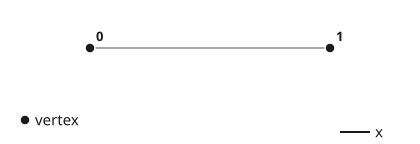
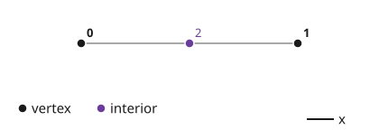
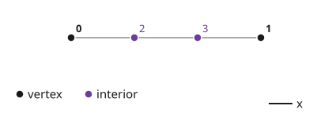

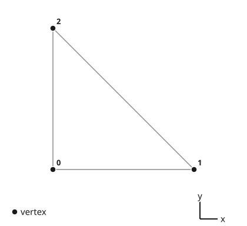
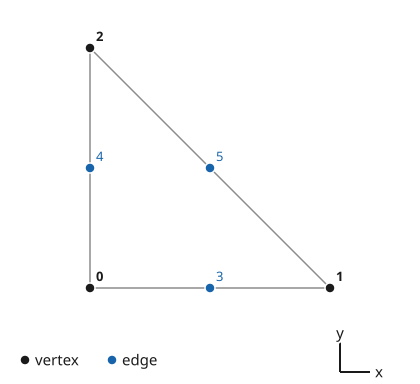
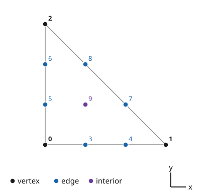

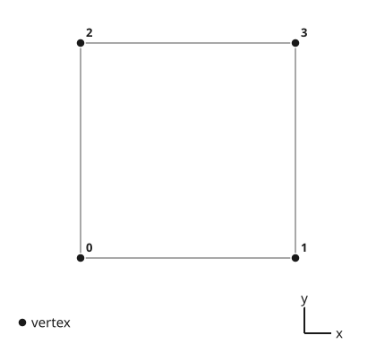
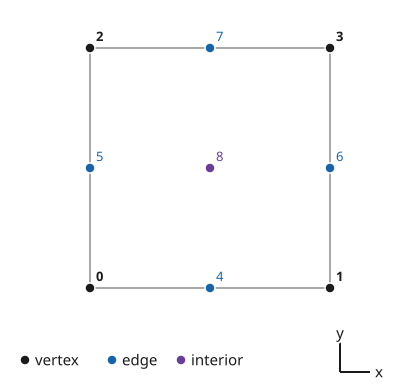
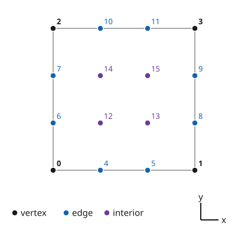

For the triangle of degree 3, the nodes and their reference coordinates are:

| Node | Block | Coordinates |
| --- | --- | --- |
| 0, 1, 2 | vertices | $(0,0)$, $(1,0)$, $(0,1)$ |
| 3, 4 | edge 0, from vertex 0 to 1 | $(\tfrac13, 0)$, $(\tfrac23, 0)$ |
| 5, 6 | edge 1, from vertex 0 to 2 | $(0, \tfrac13)$, $(0, \tfrac23)$ |
| 7, 8 | edge 2, from vertex 1 to 2 | $(\tfrac23, \tfrac13)$, $(\tfrac13, \tfrac23)$ |
| 9 | interior | $(\tfrac13, \tfrac13)$ |

```rust
use tetraloma::{CellType, NodeFamily};
use tetraloma_refcell::{lagrange_entity_nodes, lagrange_points};

let cell = CellType::Triangle;
let points = lagrange_points(cell, 3, NodeFamily::Equispaced)?;
let (a, b) = (1.0 / 3.0, 2.0 / 3.0);
let table = [
    [0.0, 0.0], [1.0, 0.0], [0.0, 1.0], // vertices
    [a, 0.0], [b, 0.0],                 // edge 0
    [0.0, a], [0.0, b],                 // edge 1
    [b, a], [a, b],                     // edge 2
    [a, a],                             // interior
];
assert_eq!(points.len(), 2 * table.len());
for (x, want) in points.chunks_exact(2).zip(table) {
    assert!((x[0] - want[0]).abs() < 1e-15 && (x[1] - want[1]).abs() < 1e-15);
}
// The blocks: nodes 7 and 8 belong to edge 2, node 9 to the interior (dimension 2).
assert_eq!(lagrange_entity_nodes(cell, 3, 1, 2), 7..9);
assert_eq!(lagrange_entity_nodes(cell, 3, 2, 0), 9..10);
# Ok::<(), tetraloma_refcell::RefCellError>(())
```

### Tetrahedron, hexahedron, prism and pyramid

The three-dimensional cells are shown for $p = 1$ and 2. At $p = 2$ every edge has one node, at
its midpoint, and every quadrilateral face one node, at its centre. The hexahedron of degree 2
also has one interior node; the tetrahedron, prism and pyramid get interior nodes only from
$p = 4$, 3 and 3 on.

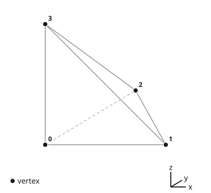
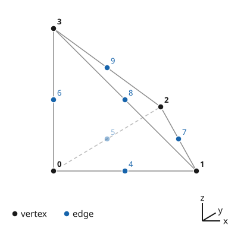

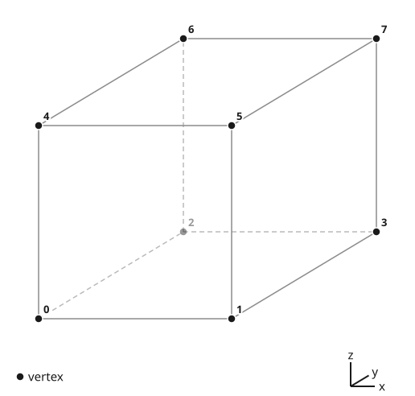
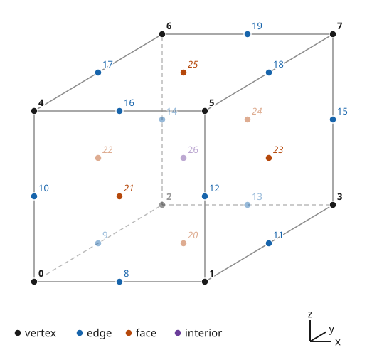

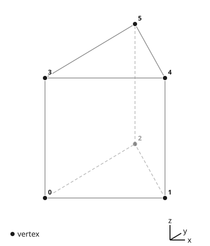
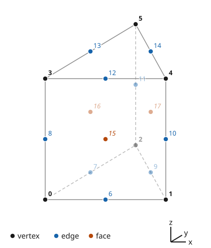

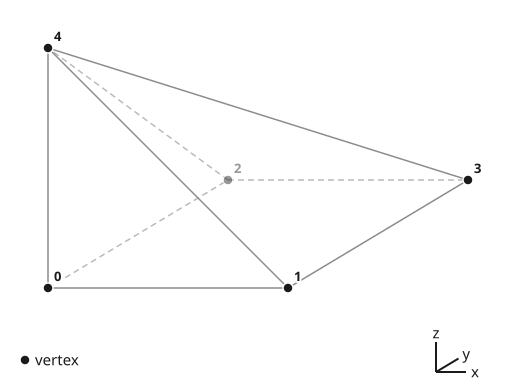
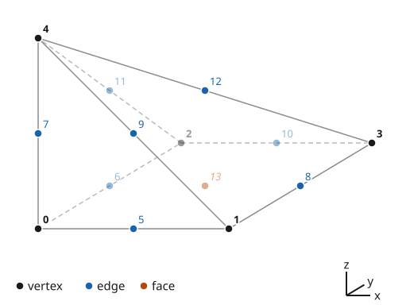

For the tetrahedron of degree 2, node $4 + e$ is the midpoint of edge $e$:

| Node | 0 | 1 | 2 | 3 | 4 | 5 | 6 | 7 | 8 | 9 |
| --- | --- | --- | --- | --- | --- | --- | --- | --- | --- | --- |
| Vertex or edge | v0 | v1 | v2 | v3 | (0,1) | (0,2) | (0,3) | (1,2) | (1,3) | (2,3) |

```rust
use tetraloma::{CellType, NodeFamily};
use tetraloma_refcell::{lagrange_points, sub_entities, vertices};

let cell = CellType::Tetrahedron;
let points = lagrange_points(cell, 2, NodeFamily::Equispaced)?;
let node = |i: usize| &points[3 * i..3 * i + 3];
for (v, x) in vertices(cell).iter().enumerate() {
    assert_eq!(node(v), *x);
}
for (e, edge) in sub_entities(cell, 1).iter().enumerate() {
    let (a, b) = (vertices(cell)[edge[0]], vertices(cell)[edge[1]]);
    let mid: Vec<f64> = a.iter().zip(b).map(|(s, t)| (s + t) / 2.0).collect();
    assert_eq!(node(4 + e), mid);
}
# Ok::<(), tetraloma_refcell::RefCellError>(())
```

## Node families

The constructions above place the edge nodes at the equispaced fractions $i/p$. tetraloma offers
two families of 1D points, chosen by
[`NodeFamily`](../api/tetraloma/enum.NodeFamily.html) in a cell block's
[`CoordinateElement`](../api/tetraloma/struct.CoordinateElement.html):

- **`Equispaced`** puts the nodes at $i/p$, on every cell. Gmsh and VTK files use these points,
  so every reader produces them and every writer converts to them before it writes.
- **`Gll`** puts the nodes at the Gauss–Lobatto–Legendre points: the two ends of $[0, 1]$ and
  the $p - 1$ roots of $P_p'$, the derivative of the Legendre polynomial of degree $p$, mapped
  from $[-1, 1]$ to $[0, 1]$. They are offered on intervals, quadrilaterals and hexahedra only,
  where they replace the equispaced points in every direction of the tensor grid.

At high degree, interpolation at GLL points is far better conditioned than at equispaced points,
which is why spectral-element codes use them. The order of the nodes is the same in both
families. Asking for GLL points on any other cell is an error: tetraloma-refcell returns
[`RefCellError::UnsupportedNodeFamily`](../api/tetraloma_refcell/enum.RefCellError.html), and
building a mesh with such a block returns
[`GridError::UnsupportedNodeFamily`](../api/tetraloma/enum.GridError.html).

For $p = 4$ the interior GLL points of the interval are $\tfrac12 \mp \tfrac12\sqrt{3/7}$ and
$\tfrac12$:

```rust
use tetraloma::{CellType, NodeFamily};
use tetraloma_refcell::{RefCellError, lagrange_points};

let points = lagrange_points(CellType::Interval, 4, NodeFamily::Gll)?;
let s = 0.5 * (3.0f64 / 7.0).sqrt();
// The two vertices first, then the edge's interior points from vertex 0 to vertex 1.
let want = [0.0, 1.0, 0.5 - s, 0.5, 0.5 + s];
for (x, w) in points.iter().zip(want) {
    assert!((x - w).abs() < 1e-14);
}
assert!(matches!(
    lagrange_points(CellType::Triangle, 4, NodeFamily::Gll),
    Err(RefCellError::UnsupportedNodeFamily { cell: CellType::Triangle, family: NodeFamily::Gll })
));
# Ok::<(), RefCellError>(())
```
