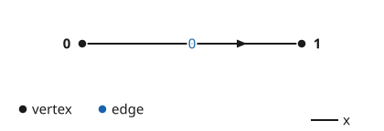
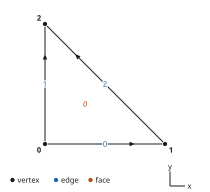
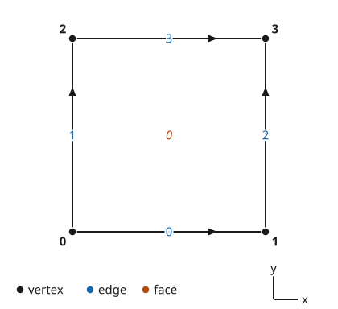
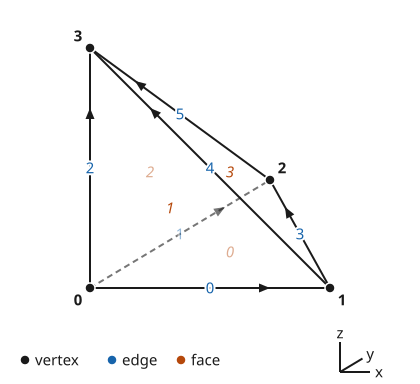
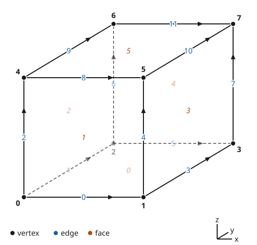
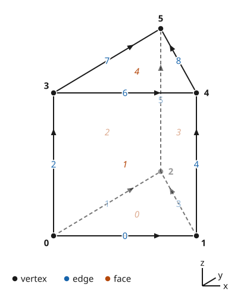
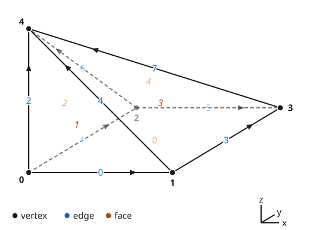

# Reference cell definitions

Every cell of a mesh is the image of a reference cell under a map, as the chapter
[Reference cells and maps](../concepts/reference-cells.md) explains. This chapter is the
reference for the seven reference cells themselves: the coordinates of their vertices, and the
numbers and vertex lists of their edges and faces. tetraloma follows the DefElement conventions,
which ndelement, Symfem and DefElement share. Basix and DOLFINx agree on the vertices but number
the edges and faces of triangles and tetrahedra in reverse; the chapter
[Basix and DOLFINx](basix-dolfinx.md) gives the conversion.

Two rules fix every table below.

- **Vertices.** Each cell has the vertices of the DefElement reference cell. The quadrilateral
  and the hexahedron list theirs in tensor (lexicographic) order: the first coordinate changes
  fastest. So the vertices of the quadrilateral are $(0,0)$, $(1,0)$, $(0,1)$, $(1,1)$, and its
  boundary runs 0–1–3–2, not 0–1–2–3.
- **Edges and faces.** The sub-entities of each dimension are numbered by their sorted vertex
  lists in lexicographic order. Edge $(0,1)$ comes before $(0,2)$, which comes before $(1,2)$.
  An edge points from its first listed vertex to its second. A quadrilateral face lists its
  vertices in its own tensor order, which is again sorted.

You can read every table from tetraloma-refcell: [`vertices`](../api/tetraloma_refcell/fn.vertices.html)
gives the coordinates, [`sub_entities`](../api/tetraloma_refcell/fn.sub_entities.html) the vertex
lists of dimension $d$, and [`sub_entity_types`](../api/tetraloma_refcell/fn.sub_entity_types.html)
their cell types. The tests under each section compare these functions with the tables, so the
tables in this chapter are the ones the library uses.

In the figures, vertex numbers are black and bold, edge numbers blue, and face numbers orange and
italic. An arrow on each edge shows its direction. A three-dimensional cell is drawn in one fixed
oblique projection: the point $(x, y, z)$ appears at $(x + 0.75\,y,\; z + 0.45\,y)$, so the
$x$–$z$ plane keeps its shape and the $y$ axis recedes up and to the right. Edges behind the cell
are dashed, and numbers on hidden parts are faded. The small axes in the corner of each figure
show the directions of $x$, $y$ and $z$.

The rule for sub-entities is a single generator, so you can rebuild any edge or face table
yourself. This test does it for every cell and checks that the result is sorted:

```rust
use tetraloma::CellType;
use tetraloma_refcell::{num_sub_entities, sub_entities, tdim, vertices};

let cells = [
    CellType::Interval,
    CellType::Triangle,
    CellType::Quadrilateral,
    CellType::Tetrahedron,
    CellType::Hexahedron,
    CellType::Prism,
    CellType::Pyramid,
];
for cell in cells {
    for dim in 0..=tdim(cell) {
        let lists = sub_entities(cell, dim);
        assert_eq!(lists.len(), num_sub_entities(cell, dim));
        // Each list is sorted, and the lists are in lexicographic order.
        assert!(lists.iter().all(|l| l.is_sorted()));
        assert!(lists.is_sorted());
    }
    // The cell itself is its only sub-entity of its own dimension.
    let all: Vec<usize> = (0..vertices(cell).len()).collect();
    assert_eq!(sub_entities(cell, tdim(cell)), [all]);
}
```

## Interval

The reference interval is $[0, 1]$. It has two vertices and one edge, the cell itself, which
points from vertex 0 to vertex 1. Its facets are its two vertices.



| Vertex | Coordinate |
| --- | --- |
| 0 | $0$ |
| 1 | $1$ |

| Edge | Vertices |
| --- | --- |
| 0 | (0, 1) |

```rust
use tetraloma::CellType;
use tetraloma_refcell::{sub_entities, vertices};

let cell = CellType::Interval;
assert_eq!(vertices(cell), [[0.0], [1.0]]);
assert_eq!(sub_entities(cell, 1), [[0, 1]]);
```

## Triangle

The reference triangle has the vertices $(0,0)$, $(1,0)$ and $(0,1)$. Its three edges are its
facets. Edge $i$ lies opposite vertex $2 - i$. Its only face is the cell itself.



| Vertex | Coordinates |
| --- | --- |
| 0 | $(0, 0)$ |
| 1 | $(1, 0)$ |
| 2 | $(0, 1)$ |

| Edge | Vertices | Opposite vertex |
| --- | --- | --- |
| 0 | (0, 1) | 2 |
| 1 | (0, 2) | 1 |
| 2 | (1, 2) | 0 |

```rust
use tetraloma::CellType;
use tetraloma_refcell::{sub_entities, vertices};

let cell = CellType::Triangle;
assert_eq!(vertices(cell), [[0.0, 0.0], [1.0, 0.0], [0.0, 1.0]]);
assert_eq!(sub_entities(cell, 1), [[0, 1], [0, 2], [1, 2]]);
assert_eq!(sub_entities(cell, 2), [[0, 1, 2]]);
// Edge i is opposite vertex 2 − i.
for (i, edge) in sub_entities(cell, 1).iter().enumerate() {
    assert!(!edge.contains(&(2 - i)));
}
```

## Quadrilateral

The reference quadrilateral is the unit square $[0,1]^2$. Its vertices are in tensor order, so
vertex $i$ has the coordinates given by the binary digits of $i$, the lowest digit first. Edges
0 and 3 run along $x$, edges 1 and 2 along $y$.



| Vertex | Coordinates |
| --- | --- |
| 0 | $(0, 0)$ |
| 1 | $(1, 0)$ |
| 2 | $(0, 1)$ |
| 3 | $(1, 1)$ |

| Edge | Vertices | Position |
| --- | --- | --- |
| 0 | (0, 1) | $y = 0$ |
| 1 | (0, 2) | $x = 0$ |
| 2 | (1, 3) | $x = 1$ |
| 3 | (2, 3) | $y = 1$ |

```rust
use tetraloma::CellType;
use tetraloma_refcell::{sub_entities, vertices};

let cell = CellType::Quadrilateral;
assert_eq!(vertices(cell), [[0.0, 0.0], [1.0, 0.0], [0.0, 1.0], [1.0, 1.0]]);
assert_eq!(sub_entities(cell, 1), [[0, 1], [0, 2], [1, 3], [2, 3]]);
assert_eq!(sub_entities(cell, 2), [[0, 1, 2, 3]]);
```

## Tetrahedron

The reference tetrahedron has its right-angled corner at the origin and the other three vertices
on the axes. Face $i$ lies opposite vertex $3 - i$, and all four faces are triangles. In the figure
you look at the cell from the side of the slanted face 3, so faces 0 and 2 are hidden.



| Vertex | Coordinates |
| --- | --- |
| 0 | $(0, 0, 0)$ |
| 1 | $(1, 0, 0)$ |
| 2 | $(0, 1, 0)$ |
| 3 | $(0, 0, 1)$ |

| Edge | Vertices |
| --- | --- |
| 0 | (0, 1) |
| 1 | (0, 2) |
| 2 | (0, 3) |
| 3 | (1, 2) |
| 4 | (1, 3) |
| 5 | (2, 3) |

| Face | Vertices | Type | Opposite vertex |
| --- | --- | --- | --- |
| 0 | (0, 1, 2) | triangle | 3 |
| 1 | (0, 1, 3) | triangle | 2 |
| 2 | (0, 2, 3) | triangle | 1 |
| 3 | (1, 2, 3) | triangle | 0 |

```rust
use tetraloma::CellType;
use tetraloma_refcell::{sub_entities, sub_entity_types, vertices};

let cell = CellType::Tetrahedron;
assert_eq!(
    vertices(cell),
    [[0.0, 0.0, 0.0], [1.0, 0.0, 0.0], [0.0, 1.0, 0.0], [0.0, 0.0, 1.0]]
);
assert_eq!(sub_entities(cell, 1), [[0, 1], [0, 2], [0, 3], [1, 2], [1, 3], [2, 3]]);
assert_eq!(sub_entities(cell, 2), [[0, 1, 2], [0, 1, 3], [0, 2, 3], [1, 2, 3]]);
assert_eq!(sub_entity_types(cell, 2), [CellType::Triangle; 4]);
// Face i is opposite vertex 3 − i.
for (i, face) in sub_entities(cell, 2).iter().enumerate() {
    assert!(!face.contains(&(3 - i)));
}
```

## Hexahedron

The reference hexahedron is the unit cube $[0,1]^3$, with its vertices in tensor order: vertex
$i$ has the coordinates given by the binary digits of $i$, the lowest digit first. Every face is
a quadrilateral that lists its vertices in its own tensor order. Faces 0 to 5 lie on the planes
$z = 0$, $y = 0$, $x = 0$, $x = 1$, $y = 1$ and $z = 1$.



| Vertex | Coordinates |
| --- | --- |
| 0 | $(0, 0, 0)$ |
| 1 | $(1, 0, 0)$ |
| 2 | $(0, 1, 0)$ |
| 3 | $(1, 1, 0)$ |
| 4 | $(0, 0, 1)$ |
| 5 | $(1, 0, 1)$ |
| 6 | $(0, 1, 1)$ |
| 7 | $(1, 1, 1)$ |

| Edge | Vertices | Edge | Vertices | Edge | Vertices |
| --- | --- | --- | --- | --- | --- |
| 0 | (0, 1) | 4 | (1, 5) | 8 | (4, 5) |
| 1 | (0, 2) | 5 | (2, 3) | 9 | (4, 6) |
| 2 | (0, 4) | 6 | (2, 6) | 10 | (5, 7) |
| 3 | (1, 3) | 7 | (3, 7) | 11 | (6, 7) |

| Face | Vertices | Type | Plane |
| --- | --- | --- | --- |
| 0 | (0, 1, 2, 3) | quadrilateral | $z = 0$ |
| 1 | (0, 1, 4, 5) | quadrilateral | $y = 0$ |
| 2 | (0, 2, 4, 6) | quadrilateral | $x = 0$ |
| 3 | (1, 3, 5, 7) | quadrilateral | $x = 1$ |
| 4 | (2, 3, 6, 7) | quadrilateral | $y = 1$ |
| 5 | (4, 5, 6, 7) | quadrilateral | $z = 1$ |

```rust
use tetraloma::CellType;
use tetraloma_refcell::{sub_entities, sub_entity_types, vertices};

let cell = CellType::Hexahedron;
assert_eq!(
    vertices(cell),
    [
        [0.0, 0.0, 0.0],
        [1.0, 0.0, 0.0],
        [0.0, 1.0, 0.0],
        [1.0, 1.0, 0.0],
        [0.0, 0.0, 1.0],
        [1.0, 0.0, 1.0],
        [0.0, 1.0, 1.0],
        [1.0, 1.0, 1.0],
    ]
);
assert_eq!(
    sub_entities(cell, 1),
    [
        [0, 1], [0, 2], [0, 4], [1, 3], [1, 5], [2, 3],
        [2, 6], [3, 7], [4, 5], [4, 6], [5, 7], [6, 7],
    ]
);
assert_eq!(
    sub_entities(cell, 2),
    [[0, 1, 2, 3], [0, 1, 4, 5], [0, 2, 4, 6], [1, 3, 5, 7], [2, 3, 6, 7], [4, 5, 6, 7]]
);
assert_eq!(sub_entity_types(cell, 2), [CellType::Quadrilateral; 6]);
// Face f lies on the plane x[axis] = value.
let planes = [(2, 0.0), (1, 0.0), (0, 0.0), (0, 1.0), (1, 1.0), (2, 1.0)];
for (face, (axis, value)) in sub_entities(cell, 2).iter().zip(planes) {
    assert!(face.iter().all(|&v| vertices(cell)[v][axis] == value));
}
```

## Prism

The reference prism (a wedge) is the reference triangle extruded along $z$ from $z = 0$ to
$z = 1$. Vertices 0 to 2 form the bottom triangle and vertices 3 to 5 the top one. Its five faces
are mixed: faces 0 and 4 are triangles, faces 1 to 3 quadrilaterals.



| Vertex | Coordinates |
| --- | --- |
| 0 | $(0, 0, 0)$ |
| 1 | $(1, 0, 0)$ |
| 2 | $(0, 1, 0)$ |
| 3 | $(0, 0, 1)$ |
| 4 | $(1, 0, 1)$ |
| 5 | $(0, 1, 1)$ |

| Edge | Vertices | Edge | Vertices | Edge | Vertices |
| --- | --- | --- | --- | --- | --- |
| 0 | (0, 1) | 3 | (1, 2) | 6 | (3, 4) |
| 1 | (0, 2) | 4 | (1, 4) | 7 | (3, 5) |
| 2 | (0, 3) | 5 | (2, 5) | 8 | (4, 5) |

| Face | Vertices | Type |
| --- | --- | --- |
| 0 | (0, 1, 2) | triangle |
| 1 | (0, 1, 3, 4) | quadrilateral |
| 2 | (0, 2, 3, 5) | quadrilateral |
| 3 | (1, 2, 4, 5) | quadrilateral |
| 4 | (3, 4, 5) | triangle |

```rust
use tetraloma::CellType;
use tetraloma_refcell::{sub_entities, sub_entity_types, vertices};

let cell = CellType::Prism;
assert_eq!(
    vertices(cell),
    [
        [0.0, 0.0, 0.0],
        [1.0, 0.0, 0.0],
        [0.0, 1.0, 0.0],
        [0.0, 0.0, 1.0],
        [1.0, 0.0, 1.0],
        [0.0, 1.0, 1.0],
    ]
);
assert_eq!(
    sub_entities(cell, 1),
    [[0, 1], [0, 2], [0, 3], [1, 2], [1, 4], [2, 5], [3, 4], [3, 5], [4, 5]]
);
let faces: [&[usize]; 5] = [&[0, 1, 2], &[0, 1, 3, 4], &[0, 2, 3, 5], &[1, 2, 4, 5], &[3, 4, 5]];
assert_eq!(sub_entities(cell, 2), faces);
use CellType::{Quadrilateral, Triangle};
assert_eq!(
    sub_entity_types(cell, 2),
    [Triangle, Quadrilateral, Quadrilateral, Quadrilateral, Triangle]
);
```

## Pyramid

The reference pyramid has the unit square as its base, with the vertices in tensor order, and
its apex above vertex 0 at $(0, 0, 1)$. Face 0 is the quadrilateral base, and faces 1 to 4 are
triangles. Because the apex sits above a corner, faces 1 and 2 are vertical.



| Vertex | Coordinates |
| --- | --- |
| 0 | $(0, 0, 0)$ |
| 1 | $(1, 0, 0)$ |
| 2 | $(0, 1, 0)$ |
| 3 | $(1, 1, 0)$ |
| 4 | $(0, 0, 1)$ |

| Edge | Vertices | Edge | Vertices |
| --- | --- | --- | --- |
| 0 | (0, 1) | 4 | (1, 4) |
| 1 | (0, 2) | 5 | (2, 3) |
| 2 | (0, 4) | 6 | (2, 4) |
| 3 | (1, 3) | 7 | (3, 4) |

| Face | Vertices | Type |
| --- | --- | --- |
| 0 | (0, 1, 2, 3) | quadrilateral |
| 1 | (0, 1, 4) | triangle |
| 2 | (0, 2, 4) | triangle |
| 3 | (1, 3, 4) | triangle |
| 4 | (2, 3, 4) | triangle |

```rust
use tetraloma::CellType;
use tetraloma_refcell::{sub_entities, sub_entity_types, vertices};

let cell = CellType::Pyramid;
assert_eq!(
    vertices(cell),
    [
        [0.0, 0.0, 0.0],
        [1.0, 0.0, 0.0],
        [0.0, 1.0, 0.0],
        [1.0, 1.0, 0.0],
        [0.0, 0.0, 1.0],
    ]
);
assert_eq!(
    sub_entities(cell, 1),
    [[0, 1], [0, 2], [0, 4], [1, 3], [1, 4], [2, 3], [2, 4], [3, 4]]
);
let faces: [&[usize]; 5] = [&[0, 1, 2, 3], &[0, 1, 4], &[0, 2, 4], &[1, 3, 4], &[2, 3, 4]];
assert_eq!(sub_entities(cell, 2), faces);
use CellType::{Quadrilateral, Triangle};
assert_eq!(
    sub_entity_types(cell, 2),
    [Quadrilateral, Triangle, Triangle, Triangle, Triangle]
);
```
